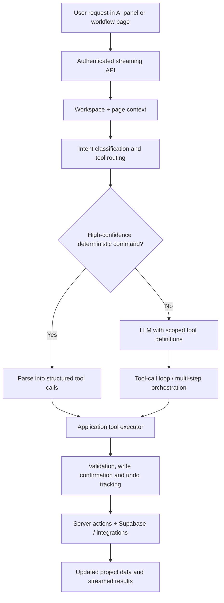

# Trak

**A full-stack project workspace with an agentic AI system that can act on the application—not just answer questions about it.**

Independently developed as an end-to-end software engineering project, Trak combines project management, structured data, collaboration, analytics, and a natural-language command layer. The central engineering challenge was giving an LLM access to meaningful application capabilities while controlling context, execution, latency, and data changes.

**Stack:** TypeScript · Next.js 16 · React 19 · Supabase/PostgreSQL · OpenAI / DeepSeek APIs · TanStack Query · TanStack Virtual · Zod · Recharts

## What it does

Trak provides workspaces with projects, hierarchical tabs, task lists, tables, timelines, documents, file attachments, charts, and collaboration features. Its AI panel and workflow pages can read workspace context and execute supported application operations using natural-language instructions.

Example commands supported by the corresponding tool categories (exact behavior depends on the current workspace, permissions, and context):

- "Create a project for Q1 planning and add a task list."
- "Find overdue tasks and organize them into a table."
- "Update the status of these tasks and assign them to a teammate."
- "Create a chart breaking down tasks by status."
- "Search our documents and summarize the relevant information."

The AI layer is **not a conventional chat wrapper**. The codebase defines **95 application tool specifications** spanning search, projects, tasks, tables, charts, timelines, blocks, documents, files, clients, comments, properties, and integrations. Models can select tools, consume results, and continue through multi-step workflows.

## AI execution architecture



Key implementation decisions:

1. **Intent-aware tool loading.** A command classifier selects relevant tool groups rather than including the entire registry in each model request. Tool schemas can be cached and warmed to avoid repeated formatting work.
2. **Hybrid deterministic/LLM execution.** High-confidence requests can take a deterministic parsing path and execute directly without an LLM round trip; more ambiguous or multi-step requests use the model-driven tool loop.
3. **Structured, contextual actions.** Tool calls operate against workspace-, project-, tab-, and block-level context. The executor includes multi-step flows, argument recovery, error handling, and tool-group expansion when needed.
4. **Streaming interaction.** The AI endpoint uses server-sent events to deliver progress, tool activity, and incremental response content.
5. **Mutation safeguards.** Write confirmations, permission-aware backend actions, and best-effort undo tracking make real data changes visible and controllable.

**Relevant source:** [AI executor](trak/src/lib/ai/executor.ts) · [Tool definitions](trak/src/lib/ai/tool-definitions.ts) · [Tool execution](trak/src/lib/ai/tool-executor.ts) · [Intent classifier](trak/src/lib/ai/intent-classifier.ts) · [Deterministic parser](trak/src/lib/ai/deterministic-parser.ts) · [Streaming API](trak/src/app/api/ai/stream/route.ts)

## Retrieval and document intelligence

Trak also includes an embedding-based retrieval pipeline for unstructured workspace content:

- Extract and chunk text from supported resources, then generate summaries and embeddings.
- Queue indexing work and skip unchanged content using SHA-256 hashes.
- Store parent-resource and chunk records in PostgreSQL with workspace access policies.
- Retrieve candidates using parent-level relevance, then score the associated chunks; the query implementation includes cosine-similarity and fallback paths.
- Feed relevant context into workspace search and AI-assisted file analysis.

**Relevant source:** [Indexer](trak/src/lib/search/indexer.ts) · [Retrieval](trak/src/lib/search/query.ts) · [Indexing queue](trak/src/lib/search/job-queue.ts) · [Embeddings](trak/src/lib/file-analysis/embeddings.ts) · [Search schema](trak/supabase/migrations/20260130235900_unstructured_search_v1.sql)

## Performance engineering

Responsiveness was an explicit engineering focus—not an afterthought. The repository includes:

| Area | Techniques implemented |
| --- | --- |
| Agent latency | Deterministic no-LLM fast paths, selective tool loading, cached schema formatting, parallel tool-call execution |
| Observability | Per-stage timing for intent classification, prompt construction, model requests, tool calls, and total execution |
| Data loading | Batched/parallel queries, selective data retrieval, and indexes for common task/table access paths |
| Frontend rendering | Virtualized task and table rows, infinite table loading, and React Query caching |
| Reliability | Retry/error handling for tool execution, confirmation gates, and undo tracking for supported writes |

These are implementation details rather than claims of independently benchmarked speedups. The repository contains performance instrumentation and audit notes; reproducible before/after latency results should be reported separately.

**Relevant source:** [Performance tracing](trak/src/lib/perf/perf-trace.ts) · [Task queries](trak/src/app/actions/tasks/query-actions.ts) · [Table queries](trak/src/app/actions/tables/query-actions.ts) · [Task view](trak/src/app/dashboard/projects/%5BprojectId%5D/tabs/%5BtabId%5D/task-block.tsx) · [Table view](trak/src/components/tables/table-view.tsx) · [Database indexes](trak/supabase/migrations/20260224000000_add_perf_indexes.sql)

## Technology overview

| Layer | Technology |
| --- | --- |
| Application | Next.js App Router, React, TypeScript, Tailwind CSS |
| Database and auth | Supabase, PostgreSQL, workspace-scoped access controls |
| AI orchestration | OpenAI / DeepSeek chat-completion APIs, structured function/tool calling, custom executor |
| Retrieval | OpenAI embeddings, chunking, background indexing jobs, similarity scoring |
| Data and UI | TanStack Query, TanStack Virtual, TipTap, Recharts, Zod |
| Integrations | Google Drive, Google Calendar, Slack, Shopify, Stripe |
| Testing | Vitest and Testing Library |

## Repository map

```text
trak/
  src/
    lib/ai/                # intent routing, LLM orchestration, tool registry/execution
    lib/search/            # indexing queue, ingestion, semantic retrieval
    lib/file-analysis/     # extraction, chunking, embeddings
    app/api/ai/            # streaming API and AI endpoints
    app/actions/           # authenticated application/data operations
    app/dashboard/         # project, table, task, and workflow interfaces
    components/            # shared UI and rich data views
  supabase/
    migrations/            # database schema evolution and access policies
  scripts/                 # supporting utilities, including performance checks
```

## Running locally

**Prerequisites:** Node.js 20 (see [`.nvmrc`](trak/.nvmrc)), npm, and a Supabase development project with the repository's database migrations applied. External integrations require their own credentials and configuration.

```bash
git clone https://github.com/pythagonacci/trakv1.git
cd trakv1/trak
nvm use            # if using nvm
npm ci
```

Create `trak/.env.local` with the credentials for your own development environment:

```dotenv
NEXT_PUBLIC_SUPABASE_URL=your_supabase_project_url
NEXT_PUBLIC_SUPABASE_ANON_KEY=your_supabase_anon_key

# Configure at least one supported chat provider for AI commands
OPENAI_API_KEY=your_openai_api_key
# DEEPSEEK_API_KEY=your_deepseek_api_key
# AI_PROVIDER=openai

# For server-side indexing/administrative jobs where required
# SUPABASE_SERVICE_ROLE_KEY=your_service_role_key
```

Apply the migrations in [`trak/supabase/migrations/`](trak/supabase/migrations) to the intended Supabase project using the Supabase CLI, then start the development server:

```bash
npm run dev
```

Open http://localhost:3000. Workspace access, sign-in, indexing, billing, and external integrations may require additional provider setup. **Never put service-role or API secrets in a public environment variable or commit `.env.local`.**

For file extraction, indexing, and RAG specifically, the current embedding implementation requires `OPENAI_API_KEY`; DeepSeek is used for supported chat and summarization paths. See the [application setup notes](trak/README.md) for more detail.

```bash
npm test             # unit tests
npm run lint         # lint checks
npm run build        # production build
```

## Project scope

This repository documents an independently built, evolving application. The AI tools and interfaces represent implemented code paths, **not a guarantee that every natural-language request will succeed in every environment**. Integrations, authentication, database migrations, and provider credentials affect which features are available. Performance improvements described above are architectural optimizations, not externally validated benchmarks.
